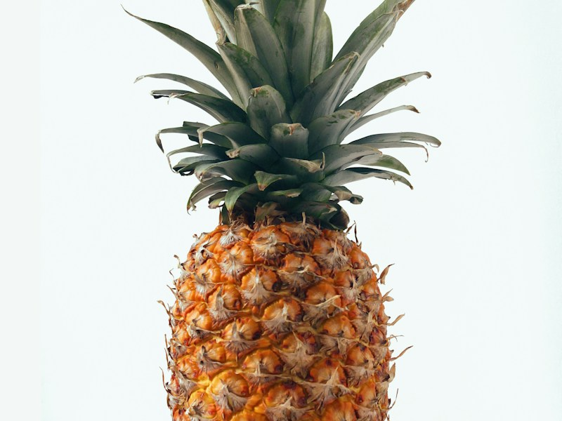

## 引人入胜的开头

在太原这座古老而现代的城市里，一种前所未有的美食体验正在悄然兴起。想象一下，当液态氮气在空气中蒸腾出梦幻般的白雾，冰激凌原料在瞬间凝固成丝滑细腻的质感，这种科学与艺术的完美结合，正在改变我们对传统冰激凌的认知。液氮冰激凌不仅仅是一种甜品，更是一场视觉与味觉的双重盛宴。在太原的许多高端餐厅和创新甜品店里，这种"瞬间魔法"已经成为吸引食客的亮点，让人们在一口品尝中感受到工业气体在美食领域的神奇魅力。

## 液氮冰激凌制作原理

液氮冰激凌的制作原理基于液氮的超低温特性和快速冷冻技术。液氮的沸点为-196℃，能够在极短时间内将冰激凌原料从液态转变为固态，这种极速冷冻过程形成了独特的微观结构。传统冰激凌制作过程中，冰晶会逐渐形成较大的颗粒，影响口感；而液氮的极速冷冻能够抑制冰晶的生长，形成极其微小的冰晶结构，从而使冰激凌具有丝滑细腻的质地。

从科学角度讲，液氮冷冻遵循"过冷"原理，即在达到凝固点时仍保持液态状态，当受到扰动或达到临界点时迅速凝固。这种物理特性使得冰激凌原料在液氮中能够均匀冻结，避免了传统冷冻方法中常见的冰粒感和粗糙质地。同时，液氮的低温还能有效抑制微生物的生长，延长冰激凌的保质期，这在食品安全方面具有重要意义。

## 制作步骤详解

制作液氮冰激凌需要专业的设备和技术，但基本步骤相对简单。首先，准备冰激凌原料，通常包括牛奶、奶油、糖和香草等基础材料，太原地区的特色还会加入本地特产如晋祠大米、汾酒等元素。将原料混合均匀后，倒入特制的搅拌容器中。

接下来是最关键的液氮添加环节。操作者需要穿戴防护装备，包括防冻手套和护目镜，然后缓慢将液氮倒入原料中。此时会看到壮观的白色雾气升腾，这是液氮与空气接触时形成的冷凝水珠。在添加液氮的同时，需要持续搅拌原料，确保冷冻均匀。

当原料开始凝固成冰激凌状时，继续搅拌至达到理想的稠度。这个过程通常只需要2-3分钟，比传统制作方法快得多。制作完成后，将冰激凌装入特制的保温容器中，即可享用。整个过程充满了戏剧性的视觉效果，让食客在等待美食的同时，也能欣赏到这场"科学魔术"的精彩表演。

## 应用场景分析

液氮冰激凌在太原地区的应用场景日益丰富，主要出现在高端餐厅、甜品店、酒店宴会和创意美食节等场合。在太原的一些精品酒店和特色餐厅中，液氮冰激凌已经成为招牌甜点，为顾客提供独特的用餐体验。特别是在婚宴和商务宴请中，液氮冰激凌的现场制作环节往往成为活动的亮点，为宾客留下深刻印象。

太原作为山西省会，拥有丰富的餐饮文化和创新精神。近年来，太原的年轻创业者们将液氮冰激凌与本地特色相结合，创造出许多创新产品。例如，将山西特产老陈醋、平遥牛肉等元素融入冰激凌制作，形成了具有地方特色的美食体验。这种创新不仅提升了太原餐饮业的竞争力，也为传统美食注入了新的活力。

此外，液氮冰激凌还在教育领域发挥着重要作用。在太原的一些科普活动和学校教育中，液氮冰激凌制作被用作物理和化学教学的生动案例，让学生在实践中理解温度变化、物质状态转换等科学原理。这种寓教于乐的方式，激发了青少年对科学知识的兴趣。

## 安全注意事项

虽然液氮冰激凌制作过程充满魅力，但安全问题是必须高度重视的。液氮具有极低的温度，直接接触会导致严重的冻伤。因此，操作人员必须穿戴专业的防护装备，包括防冻手套、护目镜和长袖工作服。在添加液氮时，应保持适当的距离，避免液氮溅到皮肤上。

操作环境也需要特别注意。液氮气化时会大量吸收热量，导致周围温度急剧下降，需要在通风良好的环境中进行操作，避免氧气浓度过低。同时，操作区域应远离易燃物品，因为液氮与某些物质接触可能产生危险反应。

在太原地区的实际应用中，许多商家已经建立了完善的安全管理制度。定期对员工进行安全培训，配备专业的应急设备，制定详细的操作规程。特别是在餐厅等公共场所，还需要考虑顾客的安全，设置隔离带，确保观赏过程的安全性。只有将安全放在首位，才能让这种创新的美食技术得到健康的发展。

## 结语

液氮冰激凌作为一种创新的美食形式，正在太原乃至全国范围内掀起一场美食革命。它不仅代表了工业气体在民用领域的创新应用，也展现了科技与美食的完美融合。在太原这座城市，传统与现代、科学与艺术正在通过液氮冰激凌这一媒介，碰撞出令人惊喜的火花。

随着人们对美食体验要求的不断提高，液氮冰激凌必将在更多领域得到应用和发展。从高端餐饮到大众消费，从专业制作到家庭体验，这种"瞬间魔法"正在改变我们的味觉世界。相信在不久的将来，液氮冰激凌将成为太原乃至全国美食文化中不可或缺的一部分，为人们带来更多美好的味觉体验。

如需了解更多高纯气体相关信息，请联系：18135156553
